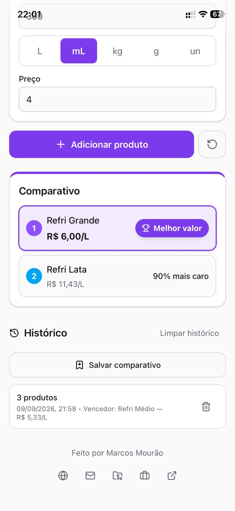
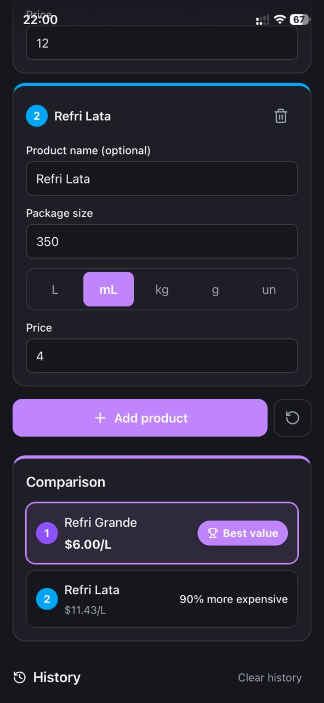
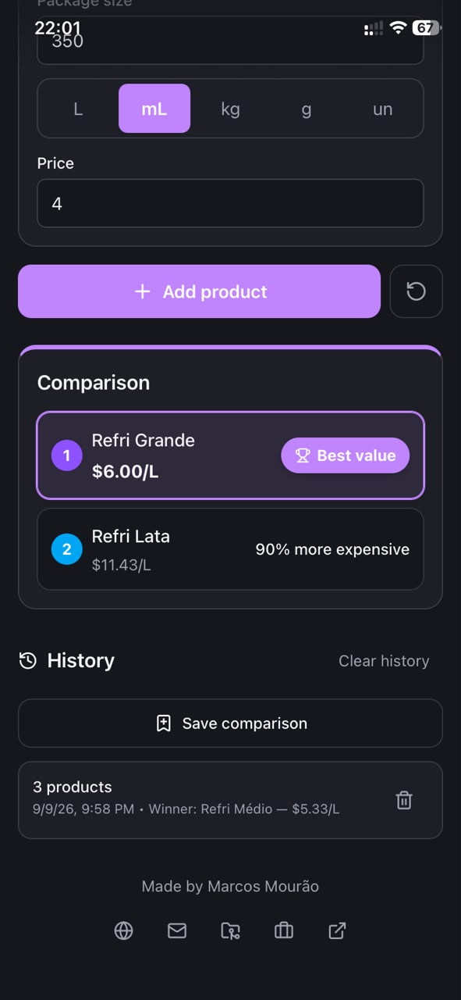

# prices — Cost-Benefit Calculator + Shopping List

Compare supermarket products by unit price and plan the trip with a local shopping list — offline, in English or Portuguese, light or dark.

**Live demo:** https://prices-mauve.vercel.app

## Why this project

A portfolio-grade, mobile-first SPA + PWA for the aisle: *2 L for $10.00 vs 1.5 L for $7.50 — which is cheaper?* Type two prices, tap the unit buttons, and the cheapest option is highlighted. **v1.1** adds a shopping list so you can plan items, check them off, and open Compare from an item to bring the winner price back onto the list.

## Features

### Compare (`/compare`)

- Compare 2+ products by normalized unit price (L, mL, kg, g, unit).
- One-tap unit selector (segmented buttons, keyboard-friendly radio pattern).
- Instant best-value badge with savings percentage; ties and mixed-unit cases handled explicitly.
- Local comparison history (last 20, restore/clear, persisted).

### Shopping list (`/`) — v1.1

- Add items by name; check off; optional paid price / quantity / unit.
- Progress (done/total) and cents-safe spend, persisted offline.
- Item sheet: mark bought, **compare options**, edit, delete.
- Handoff: seed Compare from a list item → **Use this price on the list** (mark bought or price only).
- Bottom nav: List | Compare (Compare stays usable with an empty list).

### Shared

- Offline-first PWA (precached app shell, update prompt, installable with maskable icons).
- Light/dark theme with fluid transitions, persisted, system-aware on first run.
- English default with PT-BR toggle, persisted; currency follows locale (USD/BRL via `Intl`).
- Accessible: `<main>` landmark, labeled controls, visible focus, live regions, sheet focus trap, `prefers-reduced-motion` respected.

## Tech stack

| Layer     | Choice                                            |
| --------- | ------------------------------------------------- |
| Language  | TypeScript (strict)                               |
| Framework | React 19 + Vite 8 + React Router                  |
| Styling   | Tailwind CSS 4 (class-based dark mode + tokens)   |
| State     | Zustand (`persist` for calculator/history/list)   |
| i18n      | i18next + react-i18next + browser detection       |
| PWA       | Workbox-based Vite plugin (precache + fallback)   |
| Icons     | lucide-react (tree-shaken)                        |
| Tests     | Vitest + Testing Library + jsdom (69 tests)       |

## Getting started (under 5 minutes)

Prerequisites: Node.js 20+ and npm.

```bash
npm install
npm run dev      # local dev server (online; offline works on served builds)
npm test         # unit suite (Vitest)
npm run lint     # ESLint
npm run build    # typecheck + production build to dist/
npx vite preview # serve the production build locally (PWA fully active)
```

**Demo both modes:** open `/` for the list, `/compare` for the calculator (or use the bottom nav).

To try offline mode: open the preview (or demo) URL once, wait for the app to load, then enable *Offline* in DevTools → Network and reload. Walk both routes and a list→compare handoff (checklist: `docs/04-management/list-mvp-verification.md`).

## Project structure

```text
src/
  main.tsx                 # bootstrap: styles, i18n, PWA registration
  App.tsx                  # BrowserRouter: / List, /compare Calculator + BottomNav
  app/
    App-level composition: PWA registration, preferences store
  features/calculator/
    CalculatorPage.tsx     # Compare view + handoff bar
    components/            # ProductCard, UnitSelector, ResultsList, HandoffBar, …
    hooks/ store/ lib/     # zustand + pure unit math
  features/list/
    ListPage.tsx           # checklist, progress, clear actions
    components/            # AddItemField, ListItemRow, ItemSheet, ApplyPriceDialog
    hooks/ store/ lib/     # listStore, totals, handoff seed
  components/ui/           # BottomNav, Sheet, toggles, badges, fields, …
  i18n/locales/            # en.json, pt-BR.json (no hardcoded UI strings)
  lib/                     # Intl currency helpers + tests
public/icons/              # PWA icons (192/512 + maskable + Apple touch)
docs/                      # living documentation (brief, architecture, roadmap, backlog)
```

State strategy: thin UI over persisted Zustand stores; all unit math lives in pure, unit-tested functions outside React; list orchestrates navigation and applies results without reimplementing ranking.

## Key decisions

- **Zustand over Context** — fine-grained subscriptions + persist middleware, less boilerplate.
- **Pure `lib/units.ts`** — conversions/ranking/savings isolated from React for testing; integer cents for ranking.
- **Cross-family comparison blocked** — liters vs kilos is meaningless; a localized message replaces wrong math.
- **List vs Compare mental model** — checklist plans/executes; calculator decides; handoff via `?itemId=` (AD-07–AD-10).
- **Class-based dark theme + pre-paint guard** — persisted, system-aware, no flash.
- **Explicit locale persistence** — the detector does not persist manual switches, so changes are mirrored to storage directly.

## Accessibility & quality

- `npm test` (90 tests), `npm run lint`, `npm run build` (typecheck) all green.
- Keyboard-only flow: Tab/arrows on unit groups; sheet Esc + Tab trap; bottom nav `aria-current`.
- Lighthouse targets (mobile): Performance ≥ 90, Accessibility ≥ 95, Best Practices ≥ 90.
- Release notes: `docs/04-management/release-notes-v1.1.0.md`.

## Roadmap

Calculator v1.0 → shopping list **v1.1** → **receipt/cupom** track (list → confirm → receipt, toward v1.2). See `docs/04-management/roadmap.md`, `shopping-list-backlog.md`, `receipt-backlog.md`.

## Screenshots




