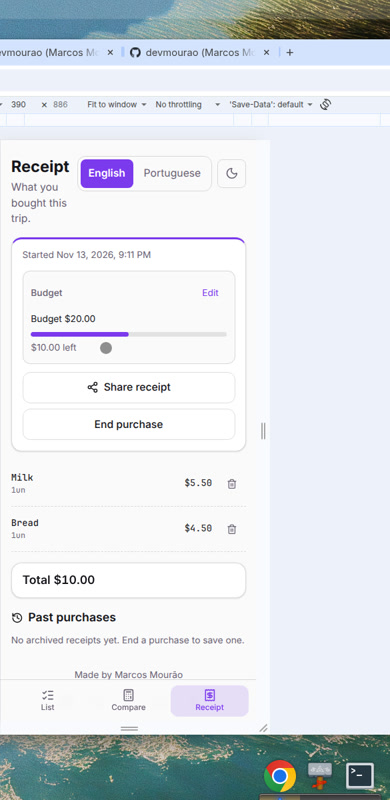
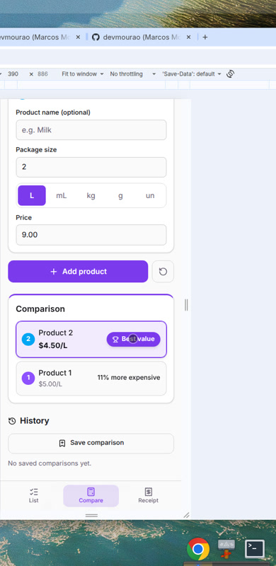

# prices — Cost-Benefit Calculator + Shopping List + Receipt

Compare supermarket products by unit price, plan the trip with a local shopping list, and record confirmed buys as a cupom-style receipt — offline, in English or Portuguese, light or dark.

**Live demo:** https://prices.mourao.info

## Why this project

A portfolio-grade, mobile-first SPA + PWA for the aisle: *2 L for $10.00 vs 1.5 L for $7.50 — which is cheaper?* Type two prices, tap the unit buttons, and the cheapest option is highlighted. **v1.2+** adds **Receipt** (confirm → cupom → archive); **v1.3** adds share, trip budget, undo, and save-winner from Compare.

## Features

### Shopping list (`/`)

- Add items by name; pending checklist focused on what’s left.
- Confirm buy (price required, qty default 1) → item leaves the list and enters the receipt.
- Item sheet: mark bought, **compare options**, edit, delete.
- Chip **Receipt · {amount}** jumps to the open cupom when lines exist.

### Compare (`/compare`)

- Compare 2+ products by normalized unit price (L, mL, kg, g, unit).
- One-tap unit selector; best-value badge; local comparison history (last 20).
- Handoff from a list item: seed Compare → **Apply and mark bought** (receipt) or **Apply price only** (stay on list).
- Standalone Compare: **Save winner to list** (match/create by name → receipt or price-only).

### Receipt (`/receipt`) — v1.2 / v1.3

- Cupom lines (name · qty · price) with sticky total (integer cents).
- Remove a line; **End purchase** archives the open receipt (frozen total, cap 20).
- Toast after confirm with **Undo**; past purchases: open a read-only archived cupom.
- **Share receipt** (Web Share / clipboard) and optional **trip budget** with remaining/overspend.
- Bottom nav: List | Compare | Receipt.

### Shared

- Offline-first PWA (precached shell, update prompt, installable).
- Light/dark theme + EN / PT-BR, persisted; currency follows locale (USD/BRL).
- Accessible: `<main>`, labeled controls, live regions, sheet focus trap, `prefers-reduced-motion`.

## Tech stack

| Layer     | Choice                                            |
| --------- | ------------------------------------------------- |
| Language  | TypeScript (strict)                               |
| Framework | React 19 + Vite 8 + React Router                  |
| Styling   | Tailwind CSS 4 (class-based dark mode + tokens)   |
| State     | Zustand (`persist` for calculator/list/purchase)  |
| i18n      | i18next + react-i18next + browser detection       |
| PWA       | Workbox-based Vite plugin (precache + fallback)   |
| Icons     | lucide-react (tree-shaken)                        |
| Tests     | Vitest + Testing Library + jsdom                  |

## Getting started (under 5 minutes)

Prerequisites: Node.js 20+ and npm.

```bash
npm install
npm run dev      # local dev server
npm test         # unit suite (Vitest)
npm run lint     # ESLint
npm run build    # typecheck + production build to dist/
npx vite preview # serve the production build locally (PWA fully active)
```

**Demo script:** `docs/04-management/release-notes-v1.3.0.md` (also v1.2.0). Offline/a11y checklist: `docs/04-management/receipt-mvp-verification.md`.

## Project structure

```text
src/
  App.tsx                  # / List, /compare Compare, /receipt Receipt + BottomNav
  features/calculator/     # Compare + handoff bar
  features/list/           # checklist, ItemSheet, ApplyPriceDialog
  features/purchase/       # ReceiptPage, purchaseStore, totals, migration
  components/ui/           # BottomNav (3 tabs), Sheet, toggles, …
  i18n/locales/            # en.json, pt-BR.json
docs/                      # brief, architecture, roadmap, backlog, release notes
```

## Key decisions

- **List vs Compare vs Receipt** — plan / decide / record (AD-07–AD-14).
- **Model B snapshots** — confirm writes immutable purchase lines; list stays pending-only.
- **Single `confirmPurchase` door** — no double accounting via list `done` + receipt.
- **Pure `lib/units.ts` + cents totals** — ranking and spend stay float-safe.
- **Zustand persist** — calculator, list, and purchase stores in `localStorage`.

## Accessibility & quality

- `npm test`, `npm run lint`, `npm run build` (typecheck) all green.
- Keyboard: unit groups, sheet Esc + Tab trap, three-tab nav `aria-current`.
- Lighthouse targets (mobile): Performance ≥ 90, Accessibility ≥ 95, Best Practices ≥ 90.
- Release notes: `docs/04-management/release-notes-v1.3.0.md`.

## Roadmap

Calculator **v1.0** → shopping list **v1.1** → receipt **v1.2** → polish **v1.3**. See `docs/04-management/roadmap.md`.

## Screenshots




